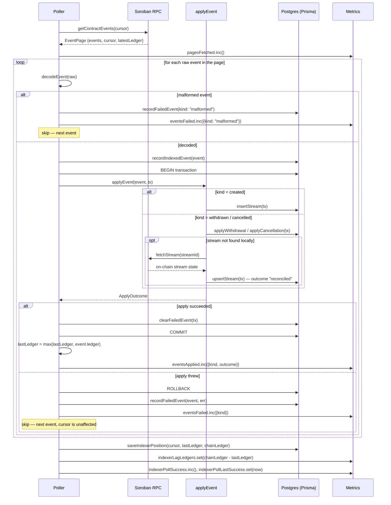

# One Poll Tick

A sequence diagram of what happens inside a single `Poller.tick()` call: fetching a page of contract events, decoding and applying them, recording failures, and saving the new position.

## Sequence diagram

## Reading the diagram

- **One page, not one event, is the unit of saved progress.** The cursor and `lastLedger` are written once per page in [`saveIndexerPosition`](../src/repositories/indexer-state.ts), after every event in the page has been attempted — not after each individual event.
- **A malformed event** (fails to decode) is recorded with `kind: "malformed"` and a placeholder `streamId: "0"`, then skipped. Decoding never touches the database or the chain.
- **A decoded event that fails to apply** runs inside a Postgres transaction with [`applyEvent`](../src/indexer/apply.ts). The transaction is rolled back, the failure is recorded in `FailedEvent`, and the loop moves to the next event — one bad event never blocks the rest of the page. See [indexer-failure-policy.md](indexer-failure-policy.md) for the full skip-and-record policy.
- **A decoded event that applies successfully** clears any stale `FailedEvent` row for the same event ID inside the same transaction, so a retried-and-now-working event removes its own failure record atomically.
- **Reconciliation** (`orReconcile` in `apply.ts`) is the only path that calls back out to the RPC: it only runs when a `withdrawn` or `cancelled` event arrives for a stream the local database does not have, typically during a backfill that starts after the stream's `created` event.
- A tick fetches and applies pages in a loop until the backlog is drained (or a per-tick page cap is hit); this diagram shows the body of that loop for a single page. See [`Poller.tick`](../src/indexer/poller.ts) for the outer loop and [backfill-duration.md](backfill-duration.md) for why pages are drained without sleeping between them.

## Related documentation

- [indexer-failure-policy.md](indexer-failure-policy.md): The skip-and-record policy applied when an event fails to decode or apply.
- [indexer-retry-backoff.md](indexer-retry-backoff.md): How the poll loop paces itself and backs off after a failed tick.
- [indexer-lag.md](indexer-lag.md): What the lag figure saved at the end of a tick means.
- [glossary.md](glossary.md): Definitions for cursor, ledger, backfill, and event application.
